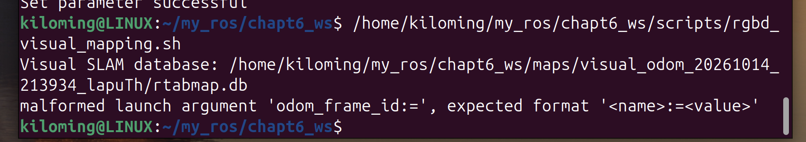
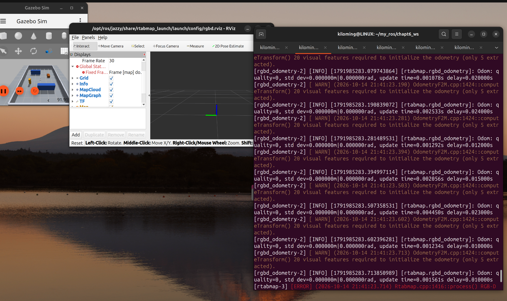
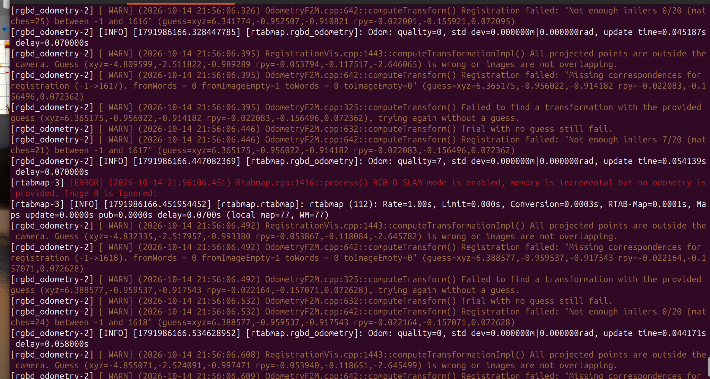
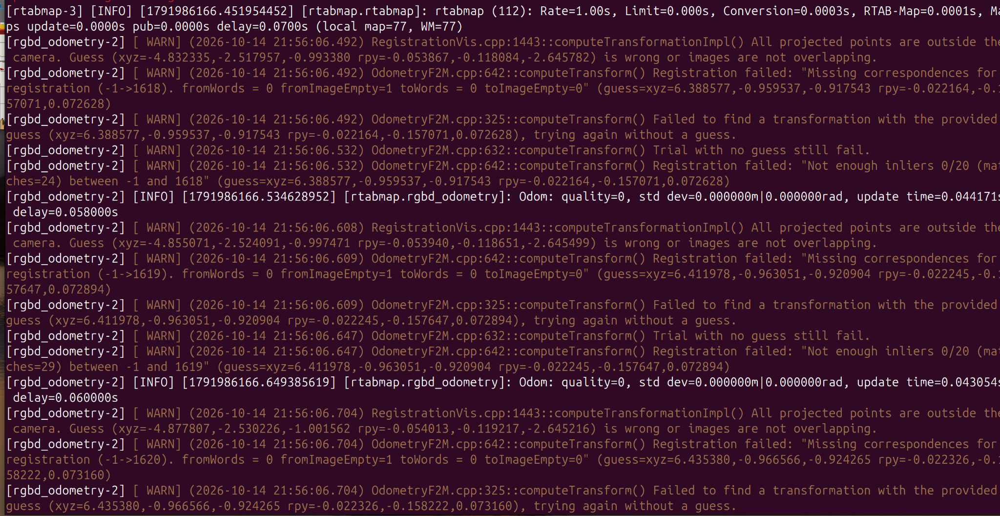

# 2026-10-14：camera_odom 切换与 RGB-D 视觉里程计跟踪失败

## 今日目标

在 ROS 2 Jazzy + Gazebo + RTAB-Map 中单独测试 RGB-D 视觉里程计，保留底盘速度控制，比较视觉 odom 与 Gazebo 真值。今天完成启动参数排错与故障证据整理，**视觉里程计在运动后频繁跟踪失败，建图尚未验收通过**。

## 闭卷回顾结果

没有新增闭卷独立复现结果。本次依据“校准camera_odom”会话、学习者描述和四张原始截图整理；未在本环境重跑 ROS2/Gazebo，不上调 MASTERY。

## 做过的代码或实验

1. 原先 RTAB-Map 使用 `/diff_drive_controller/odom`。本次设置差速控制器 `enable_odom_tf=false`，目的是关闭轮式 `odom → base_footprint` TF，**保留控制器及底盘 cmd_vel 接口**。这不等于关闭轮式 odom 话题，也不等于停止底盘。截图显示 `Set parameter successful`，但仍须检查具体 TF 是否真正停止广播。
2. 启动 RTAB-Map 的 `rgbd_odometry`，本次视觉里程计话题改为 `/camera_odom`；10 月 13 日记录中的 `/rgbd_odom` 是历史实验名称。会话中的配置要点如下，属于配置记录，不是已同步的最终 Ubuntu 脚本：

   | 参数 | 本次配置意图 |
   |---|---|
   | `visual_odometry:=true` / `icp_odometry:=false` | 使用 RGB-D 视觉里程计 |
   | `odom_topic:=/camera_odom` | RTAB-Map 接收视觉里程计 |
   | `vo_frame_id:=odom` / `frame_id:=base_footprint` | 视觉 odom 父坐标系与机器人跟踪坐标系 |
   | `publish_tf_odom:=true` / `publish_tf_map:=true` | VO 发布 odom TF，SLAM 发布 map TF |
   | `use_sim_time:=true` | 使用仿真时间 |
   | RGB / Depth / CameraInfo | `/camera/image`、`/camera/depth_image`、`/camera/camera_info` |

3. 启动脚本 `scripts/rgbd_visual_mapping.sh` 原有 `odom_frame_id:=''`。Bash 去掉引号后传入 `odom_frame_id:=`，本次 ROS Launch 报错：

   ```text
   malformed launch argument 'odom_frame_id:=', expected format '<name>:=<value>'
   ```

   本次处理是删除这一参数，使用 launch 默认空值；不要为了消除格式报错直接换成 `odom_frame_id:=odom`，后者改变 SLAM 获取里程计的方式。`vo_frame_id:=odom` 与此参数用途不同。上游 launch 的默认值及映射可见[官方源码](https://github.com/introlab/rtabmap_ros/blob/ros2/rtabmap_launch/launch/rtabmap.launch.py)，实际安装版本仍需核对。后续截图已显示 `rgbd_odometry` 在运行，说明启动推进到视觉处理阶段；最终脚本全文尚未归档。
4. 启动后先出现初始化特征不足，之后学习者反馈执行运动命令后开始漂移；21:56 截图记录连续配准失败。具体触发命令、运动方向和速度未保留，不能认定只在某种旋转动作下发生。

## 关键日志与分析

以下为截图中的关键消息摘录，长行省略了节点前缀或中间数值，并非完整原始日志：

| 日志 | 能说明什么 | 不能据此断言什么 |
|---|---|---|
| `20 visual features required to initialize the odometry (only 5 extracted)` | 初始化需要 20 个特征，本帧仅提取 5 个，无法初始化 | 不能直接判定唯一原因是环境纹理 |
| `Not enough inliers 0/20` | 几何验证内点为 0，低于门槛 20；截图包括 `matches=24` | 候选匹配数不等于可靠内点数 |
| `Not enough inliers 7/20` | 21 个候选匹配中只有 7 个内点，仍配准失败 | 不能把少量匹配或正 quality 当作成功 |
| `All projected points are outside the camera` | 当前预测下特征投影都落在视野之外 | 可能是预测、外参、视野重叠或此前失跟，尚不能确定根因 |
| `Missing correspondences for registration` | 该次配准没有所需对应关系 | 不等于已经证明 RGB 或深度话题完全没数据 |
| `Failed to find a transformation with the provided guess, trying again without a guess` | 使用预测配准失败，回退到不使用预测重试 | 不等于重试成功 |
| `Trial with no guess still fail` | 无预测的重试仍失败 | 不能断言仅关闭预测即可修复 |
| `Odom: quality=0` | 结合配准失败日志，当前估计不可用 | 节点活着或 odom 有频率不能证明跟踪有效 |
| `RGB-D SLAM mode is enabled, memory is incremental but no odometry is provided. Image 0 is ignored!` | SLAM 当前没有可用里程计，因此忽略图像 | 与上游失败一致，但还需核对订阅、时间戳和 TF，不能只凭此句确定根因 |

截图还记录了：

```text
Guess (xyz=-4.832335,-2.517957,-0.993380
       rpy=-0.053867,-0.118084,-2.645782)
is wrong or images are not overlapping.
```

这组值值得排查，但 **guess 不是 Gazebo 真值，也不一定是一帧间的位移**；不同配准层级的 guess 不应直接混算。不能据此声称机器人单帧移动了 4.83 m。截图中 `quality=7` 紧邻 `Not enough inliers 7/20` 与 SLAM 拒绝图像，所以静止测试也要结合配准结果、lost、内点、协方差和 TF 连续性，不能只要求 quality 大于 0。

## 当前结论与待查原因

已确认的问题是特征不足导致初始化失败，以及后续连续配准/跟踪失败；学习者观察到运动后漂移。优先检查运动预测来源、相机 TF/外参、RGB-D 配准，再结合低纹理/特征不足、图像帧率与同步、重复 TF 逐项排除。当前证据不足以确认其中某一项是唯一根因。

`enable_odom_tf=false` 设置成功不能证明轮式 TF 已停止；`/tf` 有多个发布者也不能单独证明冲突，必须确认它们是否发布同一条父子变换。目标链路为 `map → odom → base_footprint → base_link → camera_link → camera_optical_frame`，其中 `odom → base_footprint` 应只有本次 VO 一个有效发布来源。

**降低 `Vis/MinInliers` 没有经过验证，不是本次修复。** 本次只处理了启动参数问题，没有证据表明预测、标定、同步或漂移故障已解决。

## 下一次测试（尚未执行）

1. 停车并让相机对准有纹理的物体，先做连续静止观察。保存 quality、配准日志、`odom_info`、`/camera_odom` 位姿/协方差和 TF；静止时仍失跟则先解决输入与估计问题，不继续累计地图。
2. 核对实际节点名后检查预测与 TF 发布者，先记录参数值，再做单变量实验：

   ```bash
   ros2 param get /rtabmap/rgbd_odometry guess_frame_id
   ros2 param get /rtabmap/rgbd_odometry 'Odom/GuessMotion'
   ros2 param get /diff_drive_controller enable_odom_tf
   ros2 topic info -v /tf
   ros2 topic info -v /camera_odom
   ros2 topic echo --once /camera_odom --field pose.covariance
   ros2 topic echo --once /rtabmap/odom_info
   ros2 run tf2_ros tf2_echo odom base_footprint
   ```

   `guess_frame_id` 用于外部 TF 预测，`Odom/GuessMotion` 对应内部运动预测；本次实际值未知。结合节点配置与 TF 内容确认发布来源，必要时检查控制器 YAML 并重启后复核，不补静态 odom TF 掩盖失跟。
3. 检查 RGB/Depth 画面、深度有效值与单位、CameraInfo 尺寸/内参、相机安装外参与 optical frame。记录同窗口 RGB/Depth/同步 RGB-D 的频率、时间戳、QoS、仿真实时率；先发现实际同步话题名称，再观测，不能把顺序读取的不同帧时间差直接当成同步错误。
4. 静止有效跟踪稳定后，分开做低速前进、后退、左转、右转，每次运动后停车观察。初始计划直行约 `0.05 m/s`，旋转约 `±0.1 rad/s`，这是待测速度，不是今天已执行数据。控制接口及消息类型以当前底盘为准。
5. 按相同时间基和初始坐标对齐，比较 Gazebo 真值与 `/camera_odom` 的相对位移、yaw、回到起点的残差和失跟次数；轮式 odom 可留作辅助对照。先核实 Gazebo 实际真值话题/接口，不猜测名称。保存每次指令、时长与结果，不能用“速度 × 时间”代替真值。
6. 逐文件同步 Ubuntu 最终脚本、控制器 YAML、相机 Xacro、world、参数 dump 和完整日志。保留轮式基线与独立数据库。视觉 odom 未稳定前不进入 Nav2 验收。

## 今日真正掌握与证据边界

本次整理了启动参数解析、里程计话题与 TF 的区别，以及“提取特征 → 候选匹配 → 几何内点 → 有效位姿 → SLAM”的故障链；独立掌握程度仍待复现检验。仓库本次只更新文档与截图，不把会话中的建议当成已验证的源码修改，不声称重新构建或完成了定量校准。

## 原始截图归档

来源：ChatGPT 会话“校准camera_odom”（`6acf7e99-ebcc-83e8-8787-ab0466f07508`）。以下四张 PNG 按原文件复制，仅重命名，未裁剪或重绘；文件名时间为 2026-10-14 本地时间。

### 21:39:52：Launch 空参数报错



### 21:41:29：初始化特征只有 5 个



### 21:56:32：预测、内点和 SLAM 拒绝图像



### 21:56:40：连续无预测重试仍失败



前一日背景见 [2026-10-13](2026-10-13.md)。
